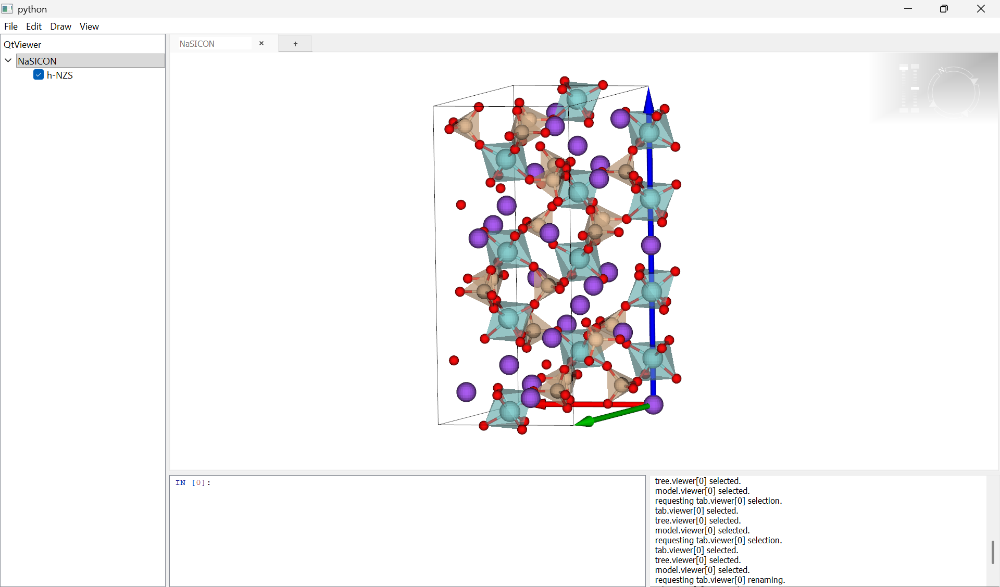
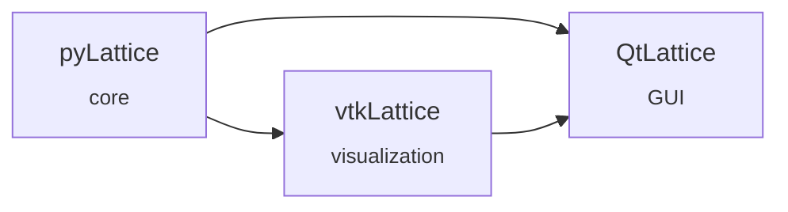

<div align="center">

# VisualLatticeModelling - ViLaMo

**A modular Python toolkit for building, visualizing and exploring crystal lattices**

[](https://www.python.org/)
[](LICENSE)

</div>

---



Lattice brings together three packages that build on one another. Each one can be installed on its own, so you only pull in the layers you actually need.

| Package | Role | Depends on |
|---|---|---|
| [**pyLattice**](pyLattice/) | Core library: lattice definition, geometry and computation | — |
| [**vtkLattice**](vtkLattice/) | 3D rendering and visualization of lattices with VTK | pyLattice |
| [**QtLattice**](QtLattice/) | Graphical desktop application built on Qt | pyLattice, vtkLattice |



## Repository structure

```
Lattice/
├── pyLattice/      # core library
├── vtkLattice/     # VTK visualization layer
├── QtLattice/      # Qt graphical interface
└── README.md
```

Each folder is a self-contained Python project with its own dependencies and documentation.

## Installation

### Install only what you need

Install each package straight from this repository with `pip`, pointing at its subfolder. Install them in this order, because each layer depends on the ones before it.

```bash
# Core only
pip install "git+https://github.com/marcobrasini/Lattice.git#subdirectory=pyLattice"

# Core + visualization
pip install "git+https://github.com/marcobrasini/Lattice.git#subdirectory=vtkLattice"

# Full stack, including the GUI
pip install "git+https://github.com/marcobrasini/Lattice.git#subdirectory=QtLattice"
```

### Development install

To work on the code, clone the repository and install the packages in editable mode:

```bash
git clone https://github.com/marcobrasini/Lattice.git
cd Lattice

python -m venv .venv
source .venv/bin/activate        # on Windows: .venv\Scripts\activate

pip install -e ./pyLattice
pip install -e ./vtkLattice
pip install -e ./QtLattice
```

## Quick start

```python
import pyLattice

# TODO: replace with a minimal working example
```

To launch the graphical interface:

```bash
# TODO: replace with the actual entry point
python -m QtLattice
```

See the README in each subfolder for detailed usage and examples.

## History

The three packages used to live in separate repositories ([pyLattice](https://github.com/marcobrazo/pyLattice), [vtkLattice](https://github.com/marcobrazo/vtkLattice), [QtLattice](https://github.com/marcobrazo/QtLattice)). They were merged here with their full commit history preserved.


## Author

**Marco Brasini** — [@marcobrasini](https://github.com/marcobrasini)

## License

Distributed under the MIT License. See [`LICENSE`](LICENSE) for details.
